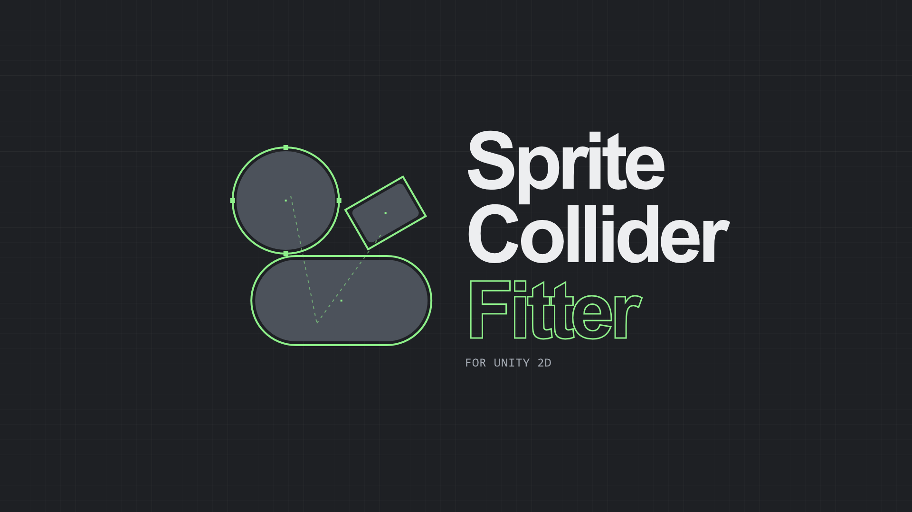

<p align="center">
  
</p>

# Sprite Primitive Collider Fitter

A Unity editor tool that replaces a sprite's polygon collider with a few fitted circles, rotated boxes and capsules, within an error tolerance. In the benchmark, 1,000 falling bodies step **5× faster** with the default fit than with Unity's generated polygons. On solid shapes the fit is as tight as those polygons or tighter; on thin, curved features it leaves more empty space.

The package, its documentation, the benchmark tables and the algorithm notes are in [`Packages/com.sejidmemic.sprite-collider-fitter`](Packages/com.sejidmemic.sprite-collider-fitter/README.md).

## Install

Unity 2022.3 or later. **Window → Package Manager → + → Add package from git URL**:

```
https://github.com/Memic-Sejid/Sprite-Collider-Fitter.git?path=/Packages/com.sejidmemic.sprite-collider-fitter
```

## This repository

This is the development project (Unity 2022.3.62f3, built-in render pipeline).

- `Packages/com.sejidmemic.sprite-collider-fitter`: the package, embedded.
- `Assets/SpriteFitBenchmark`:
  - the four sample sprites: barrel, shuriken, spaceship, sword;
  - `SpriteFitSamples.unity`, a scene with each sprite and its polygon collider, to try the tool on;
  - the package ships copies of both as its **Sample Sprites** sample, in `Samples~/SampleSprites`. Unity hides that folder. The copies have their own `.meta` files, so if you change an image here, copy only the image across.
  - the physics benchmark: **Tools → Sprite Collider Fitter → Benchmark → Run**, results in `BenchmarkResults.md`.
- `.github/workflows/tests.yml`: runs the EditMode tests with GameCI on every push. It needs the `UNITY_LICENSE`, `UNITY_EMAIL` and `UNITY_PASSWORD` repository secrets; see [GameCI activation](https://game.ci/docs/github/activation).

## License

MIT. See [LICENSE.md](LICENSE.md).
